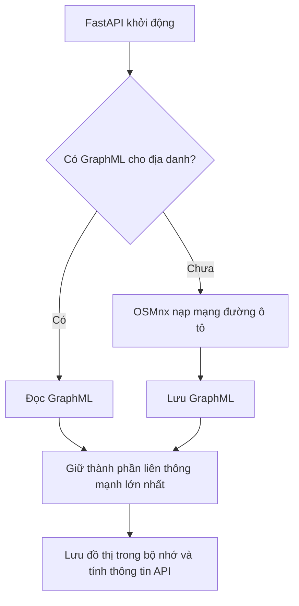

# 4.3. Tải và quản lý dữ liệu bản đồ

## 4.3.1. Phạm vi và quy trình nạp

Ứng dụng dùng mạng đường ô tô trong phạm vi Quận 1 cũ, TP.HCM. Cấu hình mặc định truyền chuỗi `District 1, Ho Chi Minh City, Vietnam` cho OSMnx. Nominatim trả ranh giới lịch sử của Quận 1, mã quan hệ OSM `2587287`. Đây là phạm vi khảo sát theo bản đồ, phù hợp để dùng một bộ dữ liệu tương đối nhỏ cho cả hai thuật toán. [1][2]

Khi FastAPI khởi động, hàm `load_graph` ưu tiên đọc GraphML tại đường dẫn `GRAPH_CACHE_PATH`. Nếu chưa có GraphML tương ứng, OSMnx lấy ranh giới địa danh từ Nominatim, truy vấn mạng đường qua Overpass và dựng một `MultiDiGraph` với cấu hình `network_type="drive"`. File GraphML lưu đồ thị trước bước lọc liên thông mạnh, gồm tọa độ nút, thuộc tính và hình học cạnh nếu có, và độ dài tính theo mét. Cache do chương trình tạo ghi kèm tên địa danh để tránh đọc nhầm khi đổi `PLACE_NAME`. Với file GraphML cũ chưa có thông tin này, tên địa danh được hiểu theo cấu hình hiện tại. [2][3]

Lưu đồ ở Hình 4.1 cho thấy hai đường nạp đều dẫn đến cùng bước lọc trước khi API sử dụng đồ thị. GraphML được ghi vào file tạm cùng thư mục và chuyển sang tên cache sau khi ghi xong. Cách này tránh để lại file cache đích bị ghi dở nếu thao tác lưu thất bại.

*Hình 4.1. Tải, lưu và chuẩn bị đồ thị cho ứng dụng.*

## 4.3.2. Lọc đồ thị và cung cấp thông tin qua API

Mạng đường có hướng. Một số đoạn gần biên hoặc nhánh đường trong vùng có thể tạo ra các nút chỉ đi tới được theo một hướng. Ứng dụng lấy **thành phần liên thông mạnh lớn nhất** để đảm bảo giữa mọi cặp nút được giữ lại đều có đường đi theo chiều các cạnh. Quyết định này giữ cho demo dễ so sánh trên nhiều cặp điểm và có thể loại các nhánh hợp lệ. Số nút, số cạnh và khung bao của API được tính lại trên đồ thị đã lọc. [2]

`GET /api/graph/info` cung cấp các trường trong Bảng 4.1. API tìm đường dùng `bbox` để kiểm tra miền tọa độ và trả HTTP 400 nếu điểm nằm ngoài khung. Khung bao là hình chữ nhật dựa trên tọa độ cực trị của các nút. Do đó, điểm nằm trong khung vẫn có thể nằm ngoài đa giác ranh giới lịch sử hoặc cách xa đường ô tô. [3]

*Bảng 4.1. Thông tin trả về từ API đồ thị*

| Trường | Ý nghĩa |
|---|---|
| `place_name` | Tên địa danh theo cấu hình |
| `node_count` | Số nút được giữ sau khi lọc |
| `edge_count` | Số cạnh có hướng được giữ, kể cả cạnh song song |
| `bbox` | `[south, west, north, east]` theo độ |
| `center` | `[lat, lng]` ở tâm hình chữ nhật bao |

## 4.3.3. Gắn tọa độ vào nút gần nhất

Hàm `nearest_node` đo khoảng cách Haversine từ tọa độ đầu vào đến từng nút bằng `osmnx.distance.great_circle`, sau đó chọn nút có khoảng cách nhỏ nhất. Phép duyệt có thời gian O(V), với V là số nút, và phần tìm cực tiểu dùng bộ nhớ phụ O(1). Cách này dùng trực tiếp OSMnx và có thể chạy độc lập với phần hiện thực hàm ước lượng trong A*. [2][3]

Các thuật toán nhận nút xuất phát và nút đích đã được gắn. Phần lệch giữa điểm bấm và hai nút gắn có thể nhìn thấy trên bản đồ. Kỹ thuật này phù hợp với truy vấn hai tọa độ đơn lẻ. Một dịch vụ theo dõi xe theo thời gian cần xét thêm hướng chuyển động, chuỗi vị trí và các cạnh ứng viên để khớp hành trình vào mạng đường.

## 4.3.4. Đo và kiểm thử

Phép đo thực hiện ngày 23/11/2026 trên Windows 11, Python 3.12.14, OSMnx 2.2.0 và NetworkX 3.7. Nominatim trả đúng đa giác Quận 1 cũ, nhưng các lần thử lấy mạng đường trực tiếp từ Overpass không thành công. Để kiểm chứng với dữ liệu thật, nhóm sử dụng phản hồi Overpass đã lưu của mạng đường TP.HCM có mốc dữ liệu OSM **03/11/2026 04:13:51 UTC**. Từ phản hồi đó, lấy các đường và nút gần Quận 1 rồi đưa vào quy trình cắt theo đa giác và đơn giản hóa của OSMnx. Kết quả được lưu dưới dạng GraphML. [1][2]

Bảng 4.2 tổng hợp kết quả. Đo bằng `perf_counter`, tính từ lúc gọi hàm đến lúc trả về. Lần dựng đầu dùng dữ liệu OSM cục bộ và bao gồm bước ghi GraphML. Năm lần đọc GraphML có chặn yêu cầu HTTP và bao gồm bước lọc liên thông mạnh. Phép đo gắn nút sử dụng 25 tọa độ trên lưới 5 × 5 nằm trong khung bao.

*Bảng 4.2. Kết quả đo trên mạng đường Quận 1 cũ*

| Hạng mục | Kết quả |
|---|---:|
| Đồ thị sau khi cắt theo vùng và đơn giản hóa, trước lọc liên thông mạnh | 953 nút, 2.013 cạnh |
| Đồ thị đưa vào API sau lọc | 913 nút, 1.951 cạnh |
| Số phần tử bị loại | 40 nút (4,2%), 62 cạnh (3,1%) |
| Dựng đồ thị từ bản chụp cục bộ và ghi GraphML, một lần đo | 3,873 s |
| Đọc GraphML và lọc, trung vị của 5 lần | 0,143 s |
| Gắn một điểm vào nút gần nhất, trung vị của 25 điểm | 6,155 ms |

Mốc 3,873 s phản ánh quá trình dựng từ bản chụp cục bộ. Thời gian tải qua mạng chưa đo được do Overpass không trả kết quả trong các lần thử. Năm lần đọc cache thành công cho thấy GraphML đủ để chạy lại với cùng dữ liệu khi không có kết nối mạng. API `GET /api/graph/info` trả HTTP 200, `bbox` bằng `[10.7539379, 106.6818282, 10.7963239, 106.7126395]` và `center` bằng `[10.7751309, 106.69723385]`. © OpenStreetMap contributors.

Bộ test dùng một đồ thị nhỏ có cạnh song song và một nút chỉ có thể đi vào. Test kiểm tra lọc đúng nút, đọc lại GraphML, nạp dữ liệu mới khi đổi địa danh, thứ tự và giá trị của khung bao, chọn nút theo khoảng cách địa lý và phản hồi của `GET /api/graph/info` sau khởi động. Các test này chạy mà không gọi OpenStreetMap. [3]

## 4.3.5. Giới hạn và hướng phát triển

Đồ án dùng `length` để tối ưu quãng đường trên mạng ô tô đã lọc. Khi gặp sự cố, năng lực thông hành hoặc tốc độ có thể giảm, nên tuyến nhanh nhất có thể đổi dù hình học bản đồ giữ nguyên. Thời gian chờ tín hiệu đèn cũng có thể ảnh hưởng tổng thời gian đi. Một hướng phát triển là dùng trọng số `travel_time` theo giây và lưu riêng khỏi `length`. Khi đó, hàm ước lượng của A* cần cùng đơn vị với trọng số, còn mô phỏng sự cố có thể thay đổi chi phí thời gian hoặc tạm loại cạnh bị đóng. [4][5]

## Tài liệu tham khảo

1. OpenStreetMap. [Quan hệ Quận 1, mã 2587287](https://www.openstreetmap.org/relation/2587287) · [Giấy phép dữ liệu](https://www.openstreetmap.org/copyright).
2. OSMnx. [User reference](https://osmnx.readthedocs.io/en/stable/user-reference.html). Các mục: `graph_from_place`, `save_graphml`, `load_graphml`, `largest_component`, `great_circle`.
3. Mã nguồn của đồ án. [Tải đồ thị](../../BE/app/graph_loader.py) · [API](../../BE/app/api/routes.py) · [Kiểm thử dữ liệu](../../BE/tests/test_graph_loader.py).
4. Lê Văn Quốc Anh, *Chuyên đề 124007 – Hệ thống Giao thông Thông minh*, bài 03 *Quản lý sự cố giao thông*, mục *Tổng quan về quản lý sự cố giao thông*.
5. Lê Văn Quốc Anh, *Chuyên đề 124007*, bài 04 *Tín hiệu đèn thông minh và mô phỏng giao thông*, mục *Điều khiển tín hiệu đèn tại các giao lộ*.
