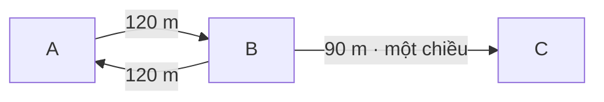

# TV2 – Bản đồ số và dữ liệu mạng đường

Bốn slide để ghép vào bài thuyết trình chung. Thời lượng khoảng 3 phút. Các đoạn trong phần lời nói dùng khi trình bày.

## Slide 1. Bản đồ số trong dịch vụ tìm đường

**Trên slide**

- ITS → Quản lý giao thông và lữ hành → Chỉ dẫn lộ trình.
- Bản đồ nền giúp đọc vị trí. Mạng đường cung cấp kết nối, chiều lưu thông và độ dài.
- Demo đề xuất tuyến theo quãng đường giữa hai điểm người dùng chọn.

**Lời nói (40 giây)**

Trong bài giảng, chỉ dẫn lộ trình thuộc nhóm quản lý giao thông và lữ hành. Đồ án minh họa một bước của dịch vụ này: dùng bản đồ số để tính và hiển thị tuyến cho người chuẩn bị di chuyển. Ảnh nền giúp ta nhận ra vị trí, còn thuật toán cần dữ liệu về cách các đường nối nhau và chiều xe được phép đi. Đó là hai vai trò của bản đồ trong demo.

## Slide 2. Từ OpenStreetMap đến đồ thị có hướng

**Trên slide**

- OSM lưu `node`, `way`, `relation` và các thẻ như `highway`, `oneway`.
- OSMnx tạo `MultiDiGraph`: nút, cạnh có hướng, chiều dài theo mét.
- Quận 1 cũ sau lọc: 913 nút, 1.951 cạnh.

**Lời nói (50 giây)**

Trên hình minh họa, A và B nối bằng đường hai chiều, còn từ B đến C chỉ có chiều đi tới C. Vì vậy, A đến C theo hai cạnh dài 210 mét, nhưng C phải dùng một tuyến khác nếu muốn quay lại B. Trong demo, OSMnx chuyển mạng đường ô tô thành đồ thị như vậy. Nhóm giữ thành phần liên thông mạnh lớn nhất để mọi cặp nút còn lại đều có đường đi. Đồ thị là đầu vào chung của Dijkstra và A*. Hình dùng số liệu giả định để minh họa.

## Slide 3. Vì sao chọn OpenStreetMap?

**Trên slide**

| Cách lấy dữ liệu | Ví dụ | Vai trò trong đồ án |
|---|---|---|
| Tải mạng đường để xử lý | OpenStreetMap + OSMnx | Chạy hai thuật toán trên cùng đồ thị |
| Gọi dịch vụ để lấy tuyến | Google Routes, HERE, Mapbox, VIETMAP, Vietbando | Khảo sát và tham khảo kết quả dịch vụ |

**Lời nói (40 giây)**

Tiêu chí chính của nhóm là lấy được dữ liệu mạng đường để tự đặt trọng số và đếm số nút đã duyệt. OpenStreetMap đáp ứng yêu cầu này và cho phép lưu đồ thị GraphML để dùng lại. Khi tham khảo kết quả từ một dịch vụ khác, mục tiêu tối ưu và hồ sơ phương tiện có thể thay đổi, nên cần đọc chúng cùng với số liệu tuyến. Dữ liệu bản đồ của demo được ghi công cho những người đóng góp OpenStreetMap.

## Slide 4. Từ điểm bấm trên bản đồ đến nút đồ thị

**Trên slide**

- WGS 84 cung cấp vĩ độ và kinh độ. Leaflet dùng Web Mercator để hiển thị.
- Haversine đo khoảng cách trên mặt cầu để chọn nút gần nhất.
- GraphML lưu đồ thị. Số liệu nạp: 3,873 s để dựng từ bản chụp OSM cục bộ, 0,143 s để đọc lại và lọc (trung vị).

**Lời nói (50 giây)**

Khi bấm lên bản đồ, vị trí nhận được là một cặp vĩ độ và kinh độ. Vì một độ kinh không có cùng độ dài ở mọi vĩ độ, backend dùng Haversine để chọn nút gần điểm bấm rồi giao hai nút cho thuật toán. Ảnh nền được hiển thị bằng phép chiếu Web Mercator. Khi tìm tuyến, chi phí đang dùng là tổng chiều dài cạnh. Trong thực tế, tuyến dài hơn vẫn có thể nhanh hơn nếu tốc độ cao hơn hoặc ít chờ ở nút giao. Phần tiếp theo sẽ trình bày cách Dijkstra và A* xử lý đồ thị này.

## Câu hỏi có thể gặp

| Câu hỏi | Gợi ý trả lời |
|---|---|
| Vì sao tuyến vẽ lệch điểm bấm? | Hai tọa độ được gắn vào nút gần nhất của đồ thị. Nút đó có thể nằm cách điểm bấm một đoạn. |
| Vì sao giữ thành phần liên thông mạnh lớn nhất? | Để từ mọi nút còn lại có thể đi tới mọi nút khác theo chiều cạnh. Một số nhánh hợp lệ có thể bị loại khỏi phạm vi demo. |
| Ảnh nền có dùng để tính đường không? | Ảnh nền giúp đọc vị trí. Backend dùng các cạnh và trọng số từ mạng đường vector. |
| Vì sao Dijkstra và A* có thể cho hai hình tuyến khác nhau? | Nhiều tuyến có thể cùng tổng độ dài tối ưu. Kiểm tra tổng độ dài trên cùng đồ thị và cặp nút. |
| Vì sao không gọi Google Routes cho demo chính? | Nhóm cần tự chạy thuật toán để quan sát các nút đã duyệt trên mạng đường tải về. |
| Thời gian chạy hiển thị có phải thời gian lái xe? | Đơn vị mili giây là thời gian máy tính thực thi thuật toán. Tuyến của demo được tối ưu theo mét. |

Nguồn và số liệu chi tiết nằm trong [chương 1](1.1-1.4-ban-do-so.md) và [mục 4.3](4.3-tai-va-quan-ly-du-lieu-ban-do.md).
